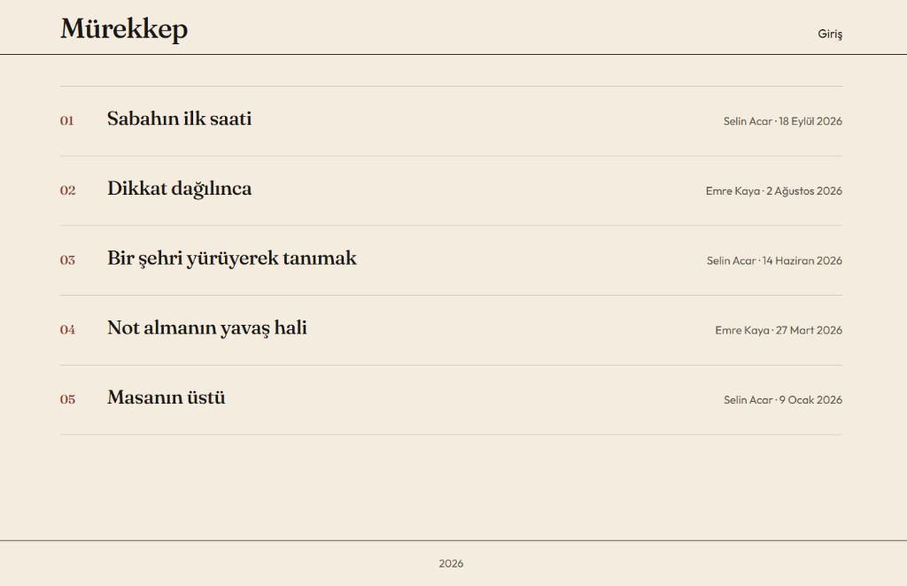
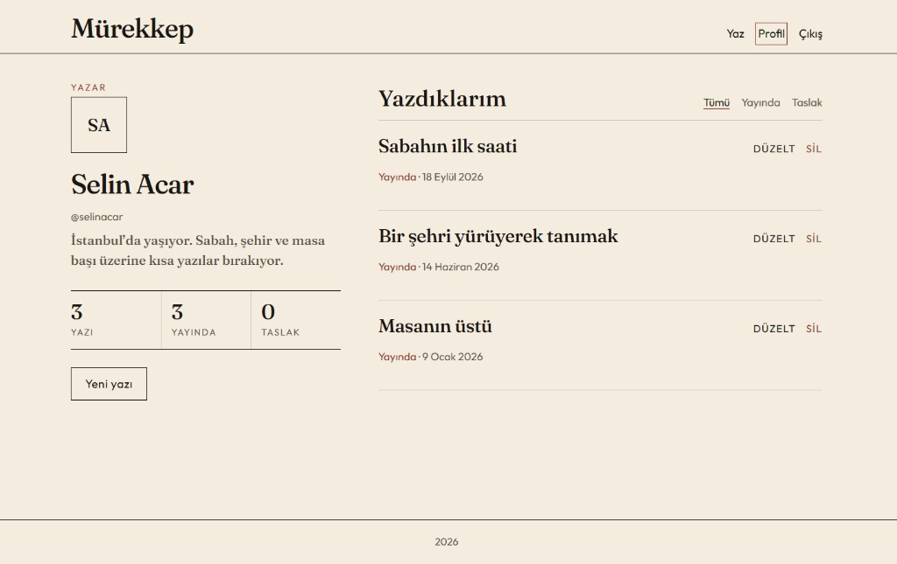
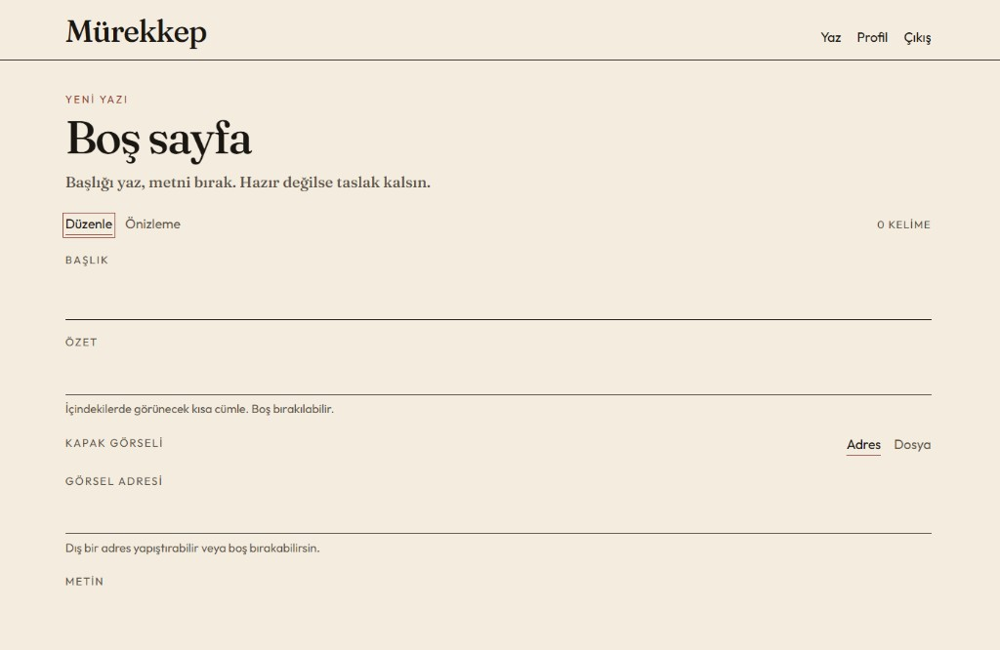
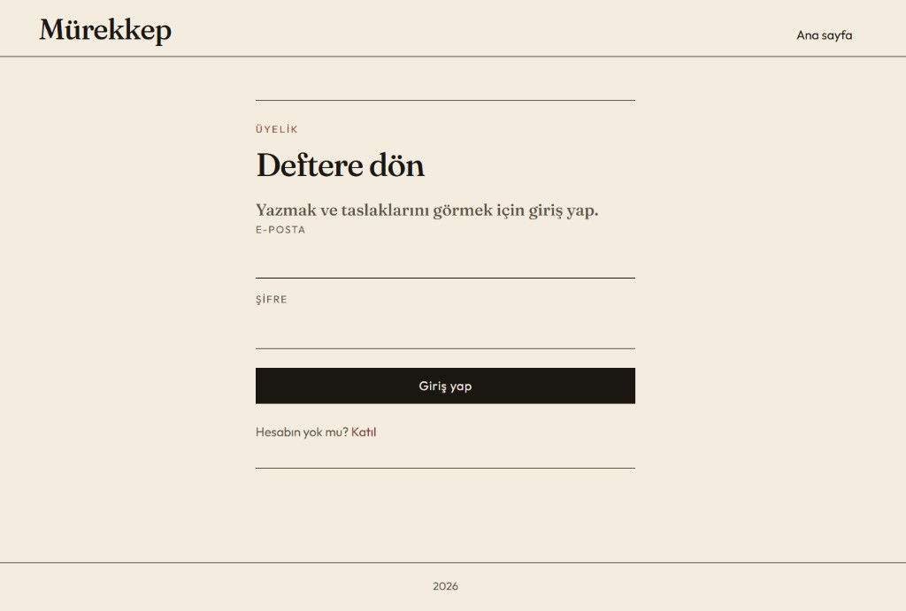
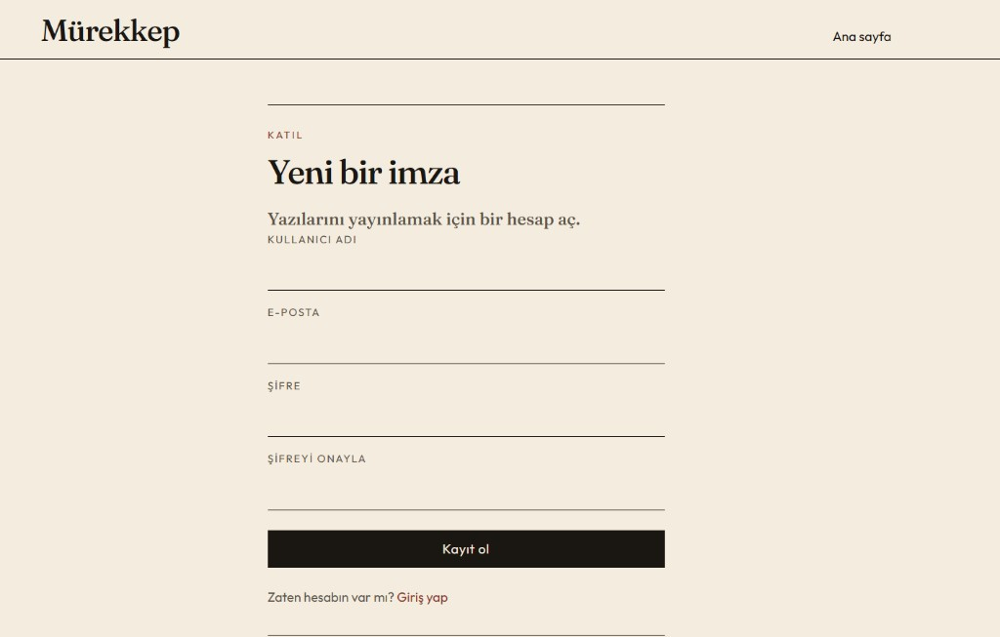

# Mürekkep

React ve Node.js ile yazılmış bir blog. Yayınlanmış yazılar herkese açık. Yazmak, düzenlemek ve profil giriş ister.

## Ekran görüntüleri

### Ana sayfa



### Yazı


### Profil



### Editör



### Giriş



### Kayıt



## Özellikler

- Herkese açık yazı listesi ve yazı sayfası. Taslaklar yalnızca yazarına görünür.
- Kayıt ve giriş. Oturum sayfa yenilenince düşmez.
- Yazı oluşturma, düzenleme, silme ve yayınlama.
- Önizlemeli editör. Satır sonları yazı sayfasında korunur.
- Kapak görseli: dosya yükleme veya dış bağlantı.
- Profilde isim, kısa tanıtım ve yazı sayıları. Liste yayında olanlar ile taslaklar arasında süzülür.

## Teknolojiler

- **Ön yüz:** React 19, React Router, Axios
- **API:** Node.js, Express, JWT, bcrypt, Multer
- **Veritabanı:** PostgreSQL, Docker üzerinde

## Gereksinimler

- Node.js 18 veya üzeri
- npm
- Docker Desktop
- Git

## Kurulum

### 1. Depoyu klonla

```bash
git clone https://github.com/furblood0/my-blog-project.git
cd my-blog-project
```

### 2. Bağımlılıkları kur

```bash
npm run install-all
```

### 3. Veritabanını başlat

```bash
docker compose up -d
```

İlk açılışta `db-init/database-schema-postgres.sql` tabloları kurar.

Veritabanını sıfırlamak için:

```bash
docker compose down -v
docker compose up -d
```

### 4. Ortam değişkenleri

API:

```bash
cd blog-backend
cp env.example .env
```

`env.example` içindeki veritabanı kullanıcısı Docker ile aynıdır. `JWT_SECRET` ve veritabanı şifresi yalnızca yerel deneme içindir.

Ön yüz isteğe bağlıdır. Tanımlı değilse adres `http://localhost:5000/api` olur.

```bash
cd frontend
cp env.example .env
```

### 5. Örnek yazılar

Kök dizinden, veritabanı ayaktayken:

```bash
npm run seed
```

Bu komut örnek hesapları ve yazıları yeniden kurar. Kendi açtığın hesaplara dokunmaz.

| E-posta | Şifre |
| --- | --- |
| selin.acar@example.com | murekkep |
| emre.kaya@example.com | murekkep |

### 6. Uygulamayı çalıştır

```bash
npm run dev
```

- Ön yüz: http://localhost:3000
- API: http://localhost:5000

Ayrı ayrı başlatmak için `npm run start-backend` ve `npm run start-frontend`.

## Proje yapısı

```
my-blog-project/
├── blog-backend/
│   ├── config/db.js
│   ├── middleware/auth.js
│   ├── scripts/seed.js
│   ├── server.js
│   └── env.example
├── frontend/
│   ├── public/
│   ├── src/
│   └── env.example
├── db-init/
│   └── database-schema-postgres.sql
├── docs/screenshots/
├── docker-compose.yml
└── package.json
```

## Komutlar

- `npm run install-all` — kök, ön yüz ve API bağımlılıklarını kurar
- `npm run dev` — API ve ön yüzü birlikte başlatır
- `npm run seed` — örnek hesap ve yazıları yükler
- `npm run build` — ön yüzün üretim derlemesini alır

## API

- `POST /api/register`
- `POST /api/login`
- `GET /api/posts` — yayınlanmış yazılar
- `GET /api/posts/:id` — tek yazı; taslak yalnızca yazarına açık
- `POST /api/posts` — giriş gerekir
- `PUT /api/posts/:id` — yazarı günceller
- `DELETE /api/posts/:id` — yazarı siler
- `POST /api/uploads/image` — kapak görseli
- `GET /api/users/:id/profile` — giriş yapan kullanıcının profili ve yazıları

## Lisans

MIT. Ayrıntı için [LICENSE](LICENSE).

## Yazar

**Furkan Fidan**
- GitHub: [@furblood0](https://github.com/furblood0)
